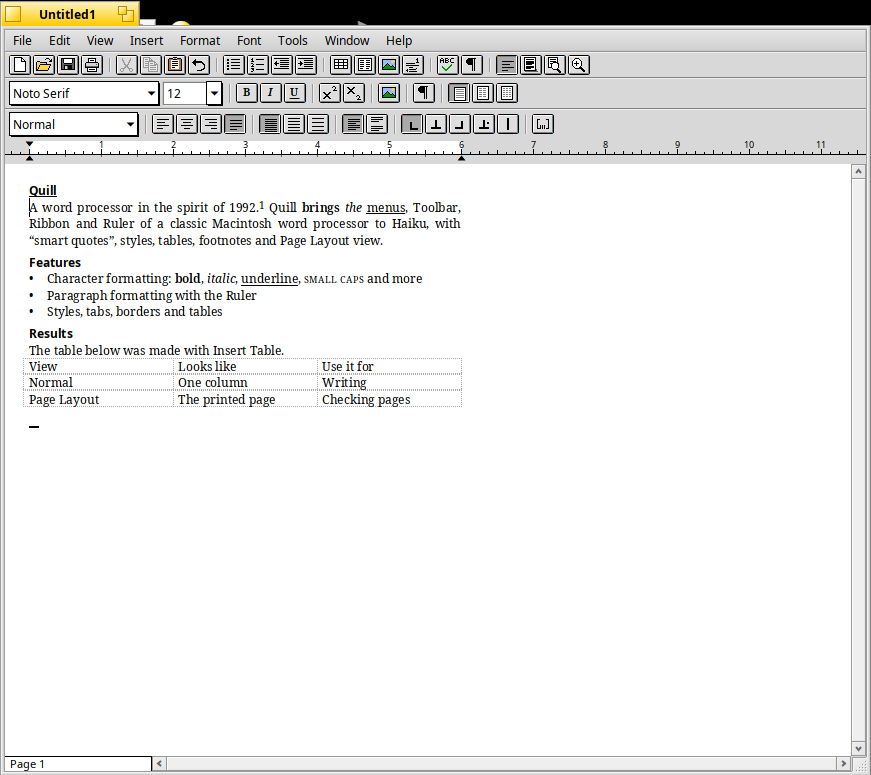
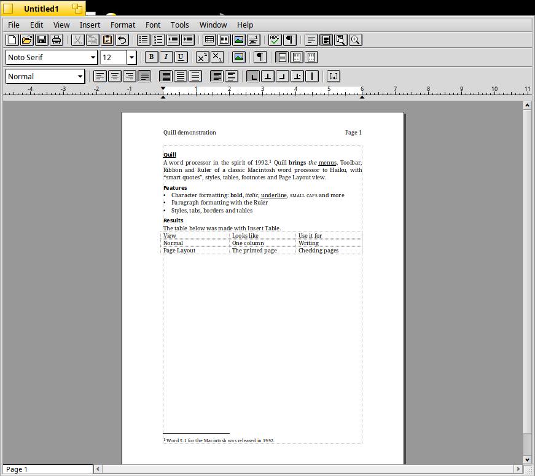
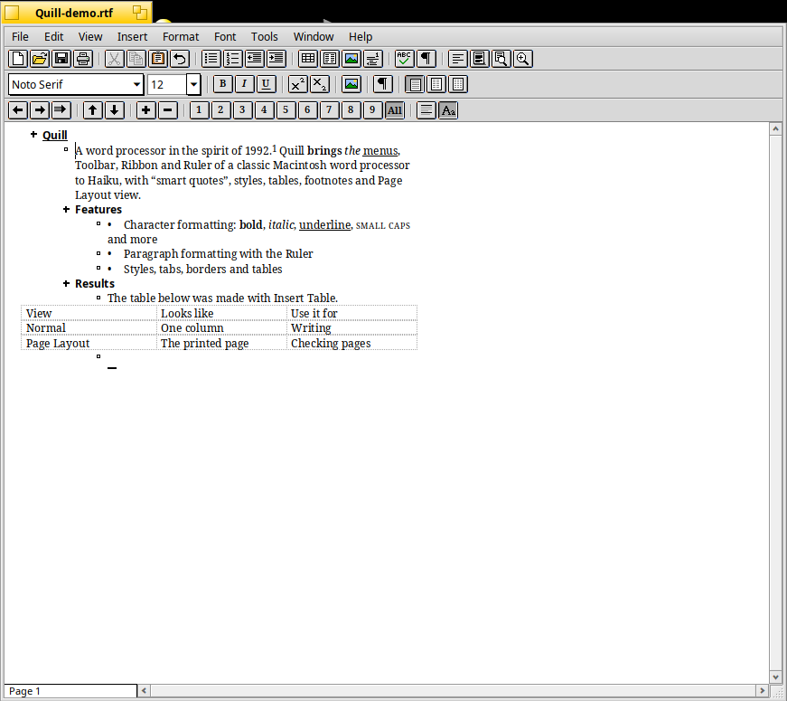

# Quill

Quill is a native Haiku word processor that recreates the look and the way
of working of Microsoft Word 5.1 for the Macintosh (1992). It is a clean-room
re-implementation: no code, resources or file-format code from Microsoft was
used, only the publicly known behaviour of the program. The name, icon and
toolbar pictures are original.

## What it does

**The Word 5.1 window.** Word's menu bar (File, Edit, View, Insert, Format,
Font, Tools, Window, Help), the Toolbar, the Ribbon (font and size, Bold,
Italic, Underline, superscript, subscript, picture, Show ¶, one to three
columns) and the Ruler (style box, alignment, line spacing, open/closed
paragraph spacing, tab types, scale button and a ruler with draggable indent
markers and tab stops), the page number box at the bottom left and the
selection bar along the left edge of the text.

**Views.** Normal view (one column, dotted page breaks, dense dots for a
manual page break, a double line for a section break, Word's end mark),
Outline view (headings by level with +, − and □ symbols, promote, demote,
demote to body text, move up and down, expand, collapse, show levels 1 to 9
or all, first line only, show formatting), Page Layout view (pages with
headers, footers, columns, footnotes and text boundaries) and Print Preview
(one or two pages, margins). Zoom from 25 % to 400 %. Show ¶ displays
spaces, tabs, line breaks and paragraph marks.

**Formatting.**
- Character: font, size (with Font > Up and Down), bold, italic, outline,
  shadow, strikethru, small caps, all caps, hidden, single, word, double and
  dotted underline, superscript and subscript by points, condensed and
  expanded spacing, Word's eight colours. Plain Text and Revert To Style.
- Paragraph: alignment, left, right and first-line indents (hanging indents
  too), spacing before and after, line spacing (auto multiple, at least,
  exactly), keep with next, keep lines together, page break before, left,
  centred, right, decimal and vertical-line tabs with dot, hyphen and line
  leaders, borders (box, sides, between, single, thick, double, dotted,
  hairline, shadow) and shading.
- Section and Document: margins, gutter and mirror margins, default tab
  stops, widow control, columns and their spacing, header and footer
  distances, a different first page, page number format and start,
  footnote position (bottom of page, beneath text, end of document).
- Page Setup: paper size, orientation and scale.
- Styles: Normal, heading 1 to 9, header, footer, footnote text and table of
  contents styles plus your own. The Style dialog defines styles by example
  or with the Character, Paragraph, Tabs and Border dialogs, with Based On
  and Next Style; redefining a style updates every paragraph that uses it.

**Document content.** Tables (Insert Table; with text selected the command
becomes Text to Table and converts paragraphs, tab or comma delimited text,
CSV quotes included, and in a table it becomes Table to Text; Table Layout to
insert and delete
rows and columns, cell widths on the Ruler's table scale, Tab moves between
cells, rows taller than a page continue on the next one), headers and footers
with page number, date and time fields, footnotes with automatic numbering,
pictures (PNG and JPEG are kept as they are, other formats are converted with
the Translation Kit), page and section breaks, symbols, the date and time,
a table of contents built from the headings, and inserting other files.

**Editing.** Unlimited undo and redo (continuous typing is one step, as in
Word), Repeat Typing, cut, copy and paste with formatting (RTF on the
clipboard) and as plain text, drag-and-drop editing (Ctrl or Option copies),
smart quotes, Find and Replace with Word's special characters (^t ^p ^n ^d
^s ^- ^~ ^w ^? ^# ^$ ^^), Go To, Glossary (with the standard date, time and
page number entries), double-click for a word, triple-click for a paragraph,
Alt-click for a sentence, the selection bar for lines, paragraphs and the
whole document, and Word's keyboard commands (see Help > Keyboard Shortcuts).

**Tools.** Spelling with Haiku's English word list (ispell affixes expanded)
and a custom dictionary, Word Count, Renumber (1. 1) I. i. A. a. or by
heading level), Bulleted and Numbered lists, Sort and Sort Descending,
Calculate (the result goes to the page number box and the clipboard),
Repaginate Now, Summary Info and Preferences.

**Files.** Documents are saved in Rich Text Format, the format Word used to
exchange documents, so Word and other word processors can open them. Quill
reads RTF written by Word for Macintosh and Windows (Mac and Windows code
pages, Unicode, style sheets, tables, fields, footnotes, headers and footers,
pictures, borders, sections), and plain text in UTF-8, UTF-16, Mac Roman or
Windows-1252. It can save Text Only and Text Only with Line Breaks. Printing
uses the Haiku print system from a thread of its own.

## Not included

Things Word 5.1 had that Quill does not do: binary Word documents (save them
as RTF in Word first), the grammar checker, thesaurus and hyphenation, print
merge, envelopes, frames (positioned objects), index generation, line
numbers, separate even and odd headers, more than one section with different
settings (a section break starts a new page, the Section dialog applies to
the whole document), a split window, voice annotations and the Publish and
Subscribe commands.

## Building

On Haiku with the development package (`haiku_devel`):

    make

The application is built as `objects.x86_64-cc13-release/Quill`. To build the
package:

    package/build-package.sh
    pkgman install package/quill-1.0.0-5-x86_64.hpkg

The package installs the application in `/boot/system/apps` and adds it to
the Deskbar's Applications menu.

## Testing

The document model, editor, layout, RTF, search, tools and spelling code is
portable C++ and has unit tests that run on any system with g++, built with
AddressSanitizer and UndefinedBehaviorSanitizer:

    tests/run-core-tests.sh [path to an ispell word list]

On Haiku, `tests/gui-test.sh` drives the application through `hey` and
checks typing, keyboard shortcuts, undo, tables, replace, styles, saving and
reopening RTF, Outline view, the table of contents and opening and closing
windows. It tests a copy of the build with its own signature
(`application/x-vnd.QuilT`, made by `tests/make-test-copy.sh`), so a Quill
you are working with is never touched; the scripts only ever kill the test
copy. `tests/q.sh` sends a single scripting command to the front window
(set `QUILL_SIG=application/x-vnd.QuilT` to talk to the test copy), for
example:

    tests/q.sh "type Hello\nWorld"
    tests/q.sh info
    tests/q.sh "post Osty"

`tests/dialogs.sh`, `tests/features.sh`, `tests/outline.sh`,
`tests/demo.sh` and `tests/perf.sh` take screenshots of the dialogs and
views and measure performance (a 1.1 MB document of 467 pages opens and is
laid out in under a second; typing costs a few milliseconds per character).

## Source

- `src/core` - portable code: the document model (`Document`, `Format`),
  editing with undo (`Editor`), line layout and pagination (`Layout`), RTF
  (`RTF`), text files (`TextIO`), Find and Replace (`Search`), paragraph
  tools (`Tools`) and spelling (`Spell`).
- `src/app` - the Haiku application: the document view (`DocView`), drawing
  (`Painter`, `PageRenderer`), the window and its menus (`DocWindow`), the
  Toolbar, Ribbon, Ruler and outline bar (`Bars`), controls (`Controls`),
  icons (`Icons`), fonts (`Fonts`), dialogs (`FormatDialogs`,
  `ToolDialogs`), panes, Print Preview and printing (`Panes`) and the
  application (`App`).
- `tools/make_icon.py` writes the vector icon (`Quill.hvif`).

See `docs/design.md` for how the pieces work.

## Authors

- John Rash
- Claude Opus 5.5

## License

MIT, see `LICENSE`.
